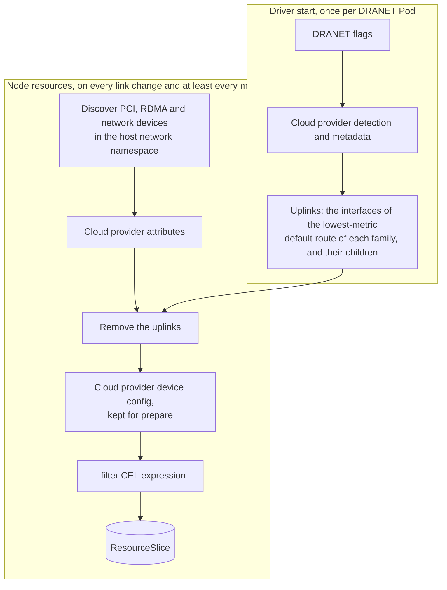
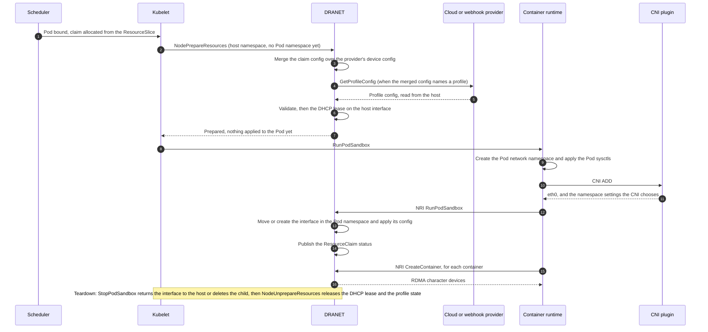

The networking DRA driver uses GRPC to communicate with the Kubelet via the [DRA API](https://github.com/kubernetes/kubernetes/blob/f141907ddd89998e821eb1047885722c8ba8922b/staging/src/k8s.io/kubelet/pkg/apis/dra/v1/api.proto) and the Container Runtime via [NRI](https://github.com/containerd/nri). This architecture facilitates the supportability and reduces the complexity of the solution, it also makes it fully compatible and agnostic of the existing CNI plugins in the cluster.

The DRA driver, once the Pod network namespaces has been created, will receive a GRPC call from the Container Runtime via NRI to execute the corresponding configuration.

DRANET configures a network device in several phases. Each phase runs at a different time, in a
different component and, for the network settings, in a different network namespace. A setting
has effect only in the phase that reads it, and a later phase can undo a setting that an earlier
phase made. When a device does not show up, or a Pod does not get the configuration it asked
for, first find the phase that made the decision, then use a setting of that phase.

## The phases

| Phase | Runs | Namespace | Decides | Settings |
|---|---|---|---|---|
| [Driver start](#driver-start) | Once, when the DRANET Pod starts | Host | The cloud provider, the profile provider, the uplink interfaces | DRANET flags |
| [Node resources](#node-resources) | On every link change, and at least every `--inventory-max-poll-interval` (1 minute) | Host | Which devices are published, with which attributes | Host network configuration, `--filter`, cloud provider |
| [Allocation](#allocation) | When the Pod is scheduled | None | Which published device a claim gets | DeviceClass and claim selectors |
| [Prepare](#prepare) | Kubelet `NodePrepareResources`, before the Pod sandbox exists | Host | The final configuration of each device | Claim `config`, profile |
| [Pod network namespace](#pod-network-namespace) | Container runtime `RunPodSandbox`: Pod sysctls, then the CNI, then DRANET | Pod | The interface in the Pod and its configuration | Pod sysctls, CNI, claim `config` and profile |
| [Containers](#containers) | NRI `CreateContainer`, for each container | Pod | The RDMA character devices of each container | None |
| [Teardown](#teardown) | NRI `StopPodSandbox`, kubelet `NodeUnprepareResources` | Pod, then host | Returning the device, releasing leases and profile state | None |

### The node resources pipeline



### The Pod path



## What each phase reads

### Driver start

DRANET reads its flags, detects the cloud provider and reads its metadata, and wires the profile
provider (`--profile-provider`). [Webhook providers](/docs/contributing/webhook-providers/) shows
the calls DRANET makes to a provider in each phase. It also computes the uplinks: the interfaces of the
lowest-metric default route of each IP family in the host's main routing table, ties included,
and every interface enslaved to one of them. The uplinks are computed once. A default route that
appears or goes away later changes them only when the DRANET Pod restarts.

The DRANET DaemonSet runs with `hostNetwork: true`. Its own Pod spec does not reach the Pod
network namespaces of the workloads, and Kubernetes rejects namespaced `net.*` sysctls on a Pod
with host networking.

### Node resources

The inventory runs in the host network namespace and has no Pod or claim context. It discovers
the devices, adds the cloud provider's attributes, removes the uplinks, keeps the cloud provider's
device config for each device, and publishes what passes `--filter`. `--filter` can only remove
devices. Nothing in a claim, a Pod, or a profile brings back a device this phase removed: change
the host, the flags, or the cloud provider instead.

### Allocation

The scheduler matches the claim's selectors against the attributes published in the
ResourceSlice. A selector on an attribute that is not published matches no device.

### Prepare

The kubelet calls `NodePrepareResources` before it creates the Pod sandbox, so there is no Pod
network namespace and the CNI has not run. DRANET merges the claim's `config` over the cloud
provider's device config, resolves the profile, validates the result, and does the host-side
work, such as the DHCP lease of `addressing: DHCP` on the host interface. A provider that resolves a profile
reads the host, for example the addresses and routes of the parent interface. The result is a
configuration; nothing is applied to the Pod yet.

A failure here fails the claim, and the kubelet retries it. The Pod stays in `ContainerCreating`
with a `FailedPrepareDynamicResources` event.

### Pod network namespace

The container runtime creates the Pod network namespace and applies the Pod's sysctls
(`spec.securityContext.sysctls`). It then runs the CNI plugin, and only then calls DRANET through
NRI `RunPodSandbox`. DRANET moves the interface into the namespace, or creates a subinterface of
it there, and applies the configuration from prepare: the per-interface sysctls, the addresses,
the link state, the routes, rules and neighbors, the VRF, the ethtool settings and the eBPF
programs. It then publishes the ResourceClaim status.

The settings of the namespace therefore come in this order, and the last one wins:

1. The Pod's sysctls.
2. The CNI plugin, which can change any namespace setting, for example disable IPv6 in the whole
   namespace.
3. DRANET, for the interfaces it adds. DRANET does not change the namespace defaults (`all` and
   `default`); the only namespace-wide settings it changes are `tcp_l3mdev_accept` and
   `udp_l3mdev_accept`, for an interface in a VRF.

A profile is resolved during prepare, before the CNI runs, but DRANET applies its output in this
phase, after the CNI. A profile can therefore override what the CNI set on the interfaces DRANET
adds, but only with what the configuration can express: the provider runs no code in the Pod
network namespace. A setting the configuration has no field for needs a change in DRANET, not in
the provider.

A failure here fails the sandbox. The Pod stays in `ContainerCreating` with
`FailedCreatePodSandBox` and `NetworkDeviceCreateFailed` events, and the runtime retries with a
new sandbox.

### Containers

For a device with RDMA, DRANET adds its character devices (`/dev/infiniband/uverbsN` and the
related devices) to each container through NRI `CreateContainer`.

### Teardown

At NRI `StopPodSandbox` DRANET returns the RDMA device and the interface to the host, or deletes
the subinterface. At `NodeUnprepareResources` it releases the DHCP lease and calls the profile
provider's `ReleaseProfileConfig`.

## Example: IPv6 RDMA NICs on an IPv4-only cluster

On this kind of node, the primary interface has an IPv4 default route and no IPv6 one. The RDMA
NICs are IPv6-only: the rail router of each one advertises a `/64` and a default route, so each
RDMA NIC has a kernel default route at metric 1024. The CNI disables IPv6 in every Pod network
namespace. Claims for the RDMA NICs fail in two phases, for two unrelated reasons.

### The RDMA NICs are not published

The ResourceSlice has none of the RDMA NICs, and the DRANET log at verbosity 2 or above says:

```
Excluded uplink interfaces and children: [eth0 rdma0 rdma1 ... rdma15]
```

This is the node resources phase. The IPv6 default routes of all the RDMA NICs tie at the lowest
IPv6 metric, so all of them are uplinks. When the primary interface has an IPv6 default route of
lower metric, it is the only IPv6 uplink and the RDMA NICs are published. An RDMA NIC that has no
default route when the DRANET Pod starts, because its router's advertisement has not arrived or
has expired, is not an uplink and is published.

The CNI does not cause this: the inventory runs in the host network namespace, where IPv6 stays
enabled. For the same reason these settings do not help:

- `net.ipv6.conf.all.disable_ipv6: "0"` in the Pod spec of the DRANET DaemonSet. Kubernetes
  rejects it because the DaemonSet uses host networking, and the host already has IPv6 enabled.
- Anything in a claim or a profile. Those phases come after the device was removed.
- `--filter`. It runs after the uplinks are removed, and can only remove devices.

The fix belongs to this phase: name the uplinks for DRANET, or let the cloud provider tell the
RDMA NICs apart from the uplinks.
<!-- Update with the cloud provider interface (`cloudprovider.UplinkFilter`) or the flag
(`--uplink-interfaces`), whichever merges. -->

### The address fails in the Pod

Once the RDMA NICs are published, a claim for one prepares, but the Pod sandbox fails:

```
failed to set up address fdcd:0:34e7:c01e:8ca1:a4c:4a77:3655/64: permission denied
```

This is the Pod network namespace phase. The CNI ran before DRANET and set `disable_ipv6` to 1
for `all`, `default`, `lo` and `eth0`. An interface that moves into or is created in the
namespace takes the namespace's default, so adding its IPv6 address fails with `EACCES`.

A Pod sysctl does not help either: the runtime applies `net.ipv6.conf.all.disable_ipv6: "0"` from
the Pod spec, then the CNI sets it back to 1.

The fix belongs to DRANET's part of this phase, after the CNI: enable IPv6 on the interface
DRANET adds, and on `lo`, through which the Pod reaches its own addresses. The cloud provider
cannot do it. Its profile returns the interface's IPv6 address during prepare, before the Pod
network namespace exists, and the configuration has no field for `disable_ipv6`. DRANET, which
applies the configuration in the namespace, can tell from the IPv6 address that the interface
needs IPv6, so neither the claim nor the provider has to know what the CNI did.
<!-- Update once the driver enables IPv6 on an interface that gets an IPv6 address, and with
`addressing: SLAAC`, once they merge. -->

### The host

Prepare also fails on an RDMA NIC that the host has not configured: one with no address in its
`/64`, or no default route, because its router does not advertise on it. That is the host's
network configuration, below every DRANET phase.

## Which setting to use

| Symptom | Phase | Use |
|---|---|---|
| A device is missing from the ResourceSlice | Node resources | The host's network configuration, `--filter`, the cloud provider. Check the log for `Excluded uplink interfaces` and `Ignoring interface`. |
| A published device is missing an attribute | Node resources | The cloud provider or the host. |
| The claim does not allocate | Allocation | The claim's selectors, against the attributes in the ResourceSlice. |
| `FailedPrepareDynamicResources` | Prepare | The claim's `config`, or the host state the profile reads. |
| `FailedCreatePodSandBox` or `NetworkDeviceCreateFailed` | Pod network namespace | The claim's `config`, or the profile. A Pod sysctl is overridden by the CNI whenever the CNI sets the same setting. |
| The Pod runs, but its interface lacks a setting | Pod network namespace | A per-interface setting in the claim's `config`. A namespace-wide setting is the CNI's. |
| An RDMA application finds no device | Containers | Check that the claim allocated an RDMA device, and the `dra.net/rdma` attribute. |
