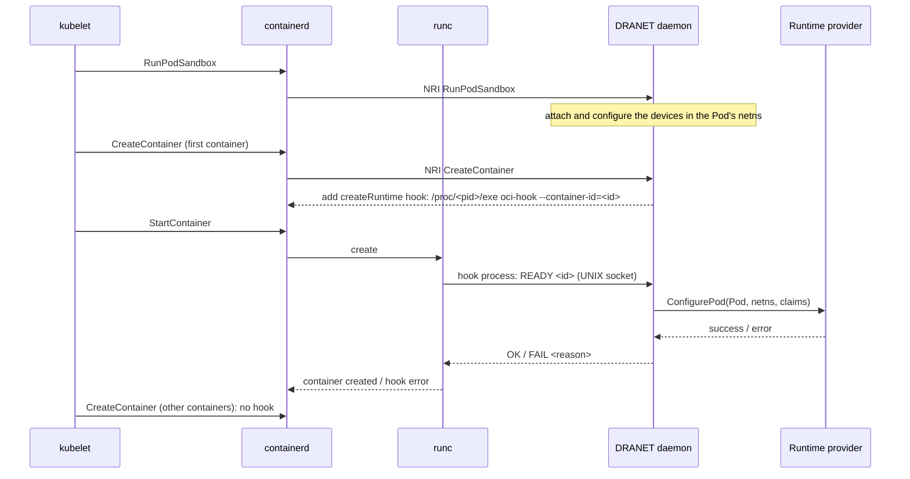

DRANET keeps its own work at the container runtime short and predictable: it
computes the network configuration of a Pod's devices at
`NodePrepareResources`, and applies it in the Pod's network namespace in the
NRI `RunPodSandbox` callback, which the runtime bounds with a two second
timeout. Some providers need to do more in that namespace before any workload
process runs, and need more time for it: program a fabric or a SmartNIC for
the Pod, load eBPF programs on the interface, run a CNI plugin, register the
Pod with an external controller. A **runtime provider** gets that window. It
is the third kind of provider, after the cloud provider (hardware discovery)
and the profile provider (user intent): it is called once per Pod sandbox,
after DRANET attached and configured the devices and before the first
container starts, with everything DRANET knows about the Pod, and it
configures the Pod's network namespace itself. It is DRANET's cloud-init for
providers.

## Mechanism

DRANET implements the call with an OCI `createRuntime` hook, which has its own
timeout and runs with the container's namespaces created and its process not
started yet. DRANET adds one to the container the kubelet creates first in the
Pod. The hook is the DRANET executable itself, run by the container runtime
with the subcommand `oci-hook`: it does nothing but connect to the daemon over
a UNIX socket, say which container is paused, and wait for the answer. The
daemon calls the runtime provider and answers `OK`, which lets the container
start, or `FAIL` with the reason, which fails the container start with that
reason in the Pod's events.

Nothing is installed on the node for this. The runtime executes hooks on the
host, where DRANET's own executable path (inside its container image) means
nothing, so DRANET points the hook at `/proc/<pid>/exe` of its own process,
with the PID the runtime sees. Executing `/proc/<pid>/exe` works wherever the
binary lives, including a `noexec` `/proc` or `/run`: the kernel checks the
executable's own file, not the path used to reach it.

The daemon keeps the provider's request for each container it adjusts, and
hands it to the hook process by container ID. The hook process carries no
state and needs no privileges beyond the runtime's. The socket, under
`/var/run/dranet` by default, is owned by root with mode `0600`.

### Resolving the daemon PID and the `hostPID: true` alternative

DRANET supports two ways to determine its `<pid>` in the host PID namespace so
the container runtime can execute `/proc/<pid>/exe`:

1. **Default (isolated PID namespace, via NRI `Synchronize`)**: When DRANET
   runs in its own container PID namespace (`hostPID: false`), it extracts its
   Kubernetes Pod UID and container name from `/proc/self/mountinfo` and
   matches its own running container (by Pod UID and command-line arguments) in
   the container list the runtime sends during NRI `Synchronize`, reading the
   host task PID reported by the runtime. This avoids granting `hostPID: true`
   to the DaemonSet, at the cost of two requirements:
   * The container runtime must populate `Container.Pid` in NRI `Synchronize`
     (containerd does).
   * The DRANET container must execute `dranet` directly as its entrypoint
     rather than wrapping it in a shell or init process (which would change the
     container's reported arguments and PID).
2. **`hostPID: true` on the DRANET DaemonSet**: If you set `hostPID: true` on
   the DRANET Pod spec, the daemon runs directly in the host's initial PID
   namespace (detected via the kernel's fixed `PROC_PID_INIT_INO` inode on
   `/proc/self/ns/pid`). In that mode, `os.Getpid()` is already the host PID:
   * `/proc/<pid>/exe` is known immediately at startup without waiting for NRI
     `Synchronize` or matching container arguments.
   * Wrapper entrypoints and runtimes that do not report `Container.Pid` over
     NRI work without restriction.

If DRANET cannot determine the host PID, it fails the creation of containers
with DRANET devices with an explicit error rather than letting them start
without the provider's configuration.

## Guarantees, persistence, and retries

The runtime provider is called **once per Pod sandbox, before the first
container starts**. When both the configured cloud provider and profile
provider implement the runtime provider capability (and are distinct provider
instances), DRANET calls both in order—cloud provider first, then profile
provider—and deduplicates when both roles are served by the same provider
instance.

Until the runtime provider succeeds, every container created in the Pod
carries the hook: the kubelet retries a container whose start failed, and may
try the Pod's other containers meanwhile, and each attempt calls the provider
again. Once it succeeds, DRANET records the completion in its node-local
checkpoint database (`--db-path`) alongside the Pod's prepared
`ResourceClaim`s. As a result, the Pod's later containers, container restarts
in the same sandbox, and containers created after a DRANET daemon restart (even
if an earlier init container already exited) do not run the hook again. A new
sandbox for the Pod (`RunPodSandbox`, `StopPodSandbox`, `RemovePodSandbox`) is
a new network namespace, clears the checkpointed completion state, and calls
the provider again.

A failure holds the Pod: no container process starts, the container start
error carries the provider's reason, DRANET records a `RuntimeProviderFailed`
event on the Pod, and the kubelet retries with its usual backoff. A provider
that fails consistently blocks the Pod until the Pod is deleted or the
provider recovers.

The provider's call is bounded by `--runtime-provider-timeout` (30s by
default, up to a maximum of 60s) minus a margin, so a slow provider is reported
with a timeout reason instead of being killed silently by the runtime. The
kubelet's `--runtime-request-timeout` (2m by default) bounds the whole
container start and must stay above it.

Providers must be idempotent. Besides the retries above, the provider is
called again after a DRANET restart if the restart happened before completion
was checkpointed, and two calls for the same Pod can overlap when the kubelet
tries another container of the Pod while the first retries.

## What the provider receives

The provider gets the Pod's identity, the path of its network namespace on
the node, and its ResourceClaims served by DRANET: each claim as DRANET
received it when it prepared the devices, and for each device its name, host
identifiers (interface name, MAC, PCI address), the network configuration
DRANET applied in the Pod and its RDMA link device. The interface inside the
Pod is `config.interface.name`. See the
[webhook provider API](../contributing/webhook-providers.md#runtime-provider-api-runtimeprovider-true)
for the request. The provider configures the Pod's network namespace; it must
not move, rename or re-address the interfaces DRANET manages.

## Configuration

Runtime providers are gated behind the alpha `RuntimeProvider` feature gate (`--feature-gates=RuntimeProvider=true`). A webhook provider declares itself a runtime provider with
`"runtimeProvider": true` in its `/health` capabilities and implements
`POST /ConfigurePod`. When `--feature-gates=RuntimeProvider=true` is set, DRANET uses it when that webhook is its cloud or
profile provider. The following flags control the mechanism:

| Flag | Default | Purpose |
|---|---|---|
| `--feature-gates=RuntimeProvider=true` | `false` (Alpha) | Enables executing configured runtime providers before a Pod's first container starts. |
| `--runtime-provider-timeout` | `30s` | Time the runtime provider has to configure a Pod (max `60s`); the OCI hook's timeout. The provider gets it minus 5s. Keep it under the kubelet's runtime request timeout. |
| `--oci-hook-socket` | `/var/run/dranet/hook.sock` | UNIX socket the OCI hook reaches the daemon through. It must be on a path shared with the host, where the runtime executes the hook; the default deployments mount `/var/run/dranet` from the host. |

## Troubleshooting

* `kubectl describe pod` shows the container start error. A provider failure
  reads `error running hook #0: ... dranet oci-hook: container <id>: runtime
  provider failed for pod <ns>/<name>: <provider's reason>`;
  `RuntimeProviderFailed` events come from DRANET with the same reason. A
  `hook ran past specified timeout` error from the runtime means the hook
  process itself was killed, which happens only when the daemon did not answer
  at all: check that the socket path is shared with the host and that the
  daemon is running.
* `the DRANET daemon is not reachable at <socket>`: the socket is not on a
  path the host sees (the DRANET container must mount `/var/run/dranet` from
  the host), or the daemon restarted.
* `no runtime provider call is pending for container <id>`: DRANET restarted
  between the container's creation and its start; the kubelet's retry
  recovers.
* `DRANET runs in its own PID namespace and the container runtime has not
  reported its container` or `the runtime reported no running container with
  the arguments of this process`: DRANET could not find itself in the
  runtime's containers. The DRANET container must run the `dranet` executable
  directly, without a wrapper, on a runtime that reports container PIDs
  through NRI (containerd does). `hostPID: true` on the DaemonSet is an
  alternative.
* `crictl inspect <container>` shows the hook in `.info.runtimeSpec.hooks.createRuntime`
  of the containers that carried it.
* The metrics `dranet_driver_runtime_provider_requests_total{status}` and
  `dranet_driver_runtime_provider_latency_seconds` count the provider calls
  and the time they held container starts.
